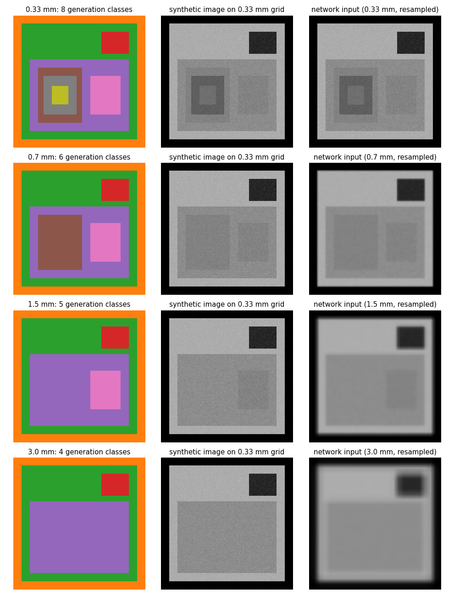
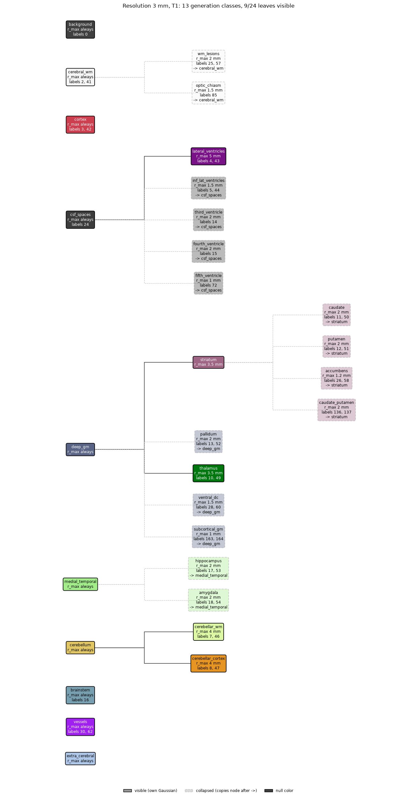
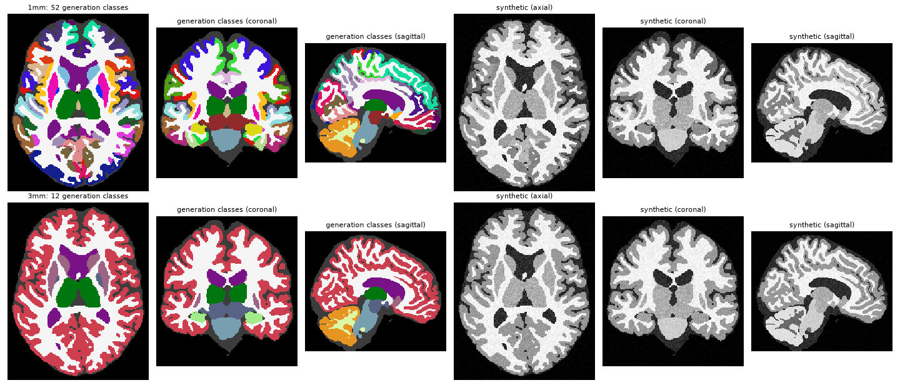

# Simple generator: tree-based, resolution-aware intensity sampling (WP3)

A small, self-contained synthetic MRI generator in the style of SynthSeg. It takes a label map
(segmentation) and produces a synthetic intensity image: each label gets a Gaussian
(mean, sigma), and every voxel is sampled from its label's Gaussian.

The difference from SynthSeg is that the label → intensity model is an **ontology tree**, not a
flat table of independent Gaussians:

- **Related structures share intensity statistics** through their common ancestors. A child
  starts from its parent's mean and moves away by a random amount controlled by `wr_mu`.
- **Structures that cannot be resolved** at the simulated voxel size or contrast **merge into
  their parent's Gaussian** automatically (`r_max`).
- The same tree tells the segmentation network (WP4) **which labels must be merged in the loss**
  at that resolution (`label_groups` / `label_set_lut`).



---

## Contents

```
simple_generator/
├── tree_sampling.py          Core library: LabelTree (the ontology) + TreeSampling (the sampler)
├── tree_plot.py              Draws a tree and marks the nodes visible / collapsed at a resolution
├── _build_synthseg_tree.py   Builds the FreeSurfer/SynthSeg tree in Python and writes it to JSON
├── example_toy.py            2D demo (nested squares), several resolutions and random contrasts
├── example_synthseg.py       3D demo on a real SynthSeg/FreeSurfer segmentation (NIfTI in/out)
├── FreeSurferColorLUT.txt    FreeSurfer color table (colors for the tree plots and class maps)
├── explanation.txt           Longer plain-text design notes
└── data/
    ├── inputs/
    │   ├── toy_tree.json             Toy tree (9 nodes, 8 labels)
    │   ├── synthseg_tree.json        SynthSeg labels (31 nodes, 43 labels)
    │   ├── synthseg_ctx_tree.json    Same + 34 bilateral DK cortical parcels under 'cortex'
    │   │                             (65 nodes, 111 labels: 1001-1035 / 2001-2035)
    │   ├── SP_T1W_3T_0006_synthseg_resampled.nii.gz                 SynthSeg segmentation
    │   └── sub-ADNI002S0295_ses-m000_space-MNI_T1wdseg_synthsr.nii.gz   segmentation with cortical parcels
    └── outputs/              Figures and NIfTI volumes produced by the examples
```

---

## Installation

Python 3.11 was used. Only standard scientific packages are needed:

```bash
conda create -y --name nxb python=3.11
conda activate nxb
pip install numpy scipy matplotlib nibabel
```

`tree_sampling.py` itself only needs `numpy`. `matplotlib` is needed for `tree_plot.py` and the
examples, and `scipy` + `nibabel` for the examples.

No other files are required. Some docstrings mention `sampling_scheme_v2.py`; that is no longer
needed, because the `SamplingScheme` base class is now included in `tree_sampling.py`.

> **Run every script from inside this folder.** The examples use relative paths such as
> `data/inputs/...` and `FreeSurferColorLUT.txt`.

---

## Quick start

```python
import numpy as np
from tree_sampling import LabelTree, TreeSampling

tree = LabelTree.from_json('data/inputs/synthseg_tree.json')   # validated on load
seg = ...                                                      # int label map (2D or 3D)

scheme = TreeSampling(np.unique(seg), tree, seed=0, std_noise=3)

C = np.array([110., 170., 40.])   # principal means  (order = tree.colors = GM, WM, CSF)
V = np.array([6., 5., 8.])        # principal sigmas

img_1mm = scheme.sample_image(seg, C, V, resolution=1.0, contrast='T1')

# Merged label sets at that resolution (for the WP4 loss)
groups = tree.label_groups(resolution=3.0, contrast='T1')      # {visible node: [labels]}
group_of, names = scheme.label_set_lut(resolution=3.0, contrast='T1')
```

Run the demos:

```bash
python example_toy.py          # 2D, no external data, ~seconds
python example_synthseg.py     # 3D, uses the NIfTI files in data/inputs/
python tree_plot.py data/inputs/toy_tree.json 0.7 T1   # see "Known issues" for the CLI
```

---

## 1. The label tree (`LabelTree`)

### JSON format

```jsonc
{
  "version": "synthseg-0.1",
  "description": "...",
  "colors":    ["GM", "WM", "CSF"],         // N principal colors; weight vectors use this order
  "contrasts": ["T1", "T2", "FLAIR", "PD"], // optional; allowed keys for r_max dicts
  "root": "root",
  "nodes": {
    "<name>": {
      "parent":   "<name>" | null,          // null only for the root
      "children": ["<name>", ...],          // must agree with each child's "parent"
      "level":    0 | 1 | 2 | ...,          // root = 0; always parent level + 1
      "labels":   [int, ...],               // label-map values painted with this node's Gaussian
                                            // (may be empty: pure group node, e.g. 'deep_gm')
      "w_mu":     [w1, ..., wN],            // level 1 only: weights over principal means (sum = 1)
      "w_sigma":  [w1, ..., wN],            // level 1 only: weights over principal sigmas (default = w_mu)
      "wr_mu":    float,                    // size of the random deviation of the mean
      "wr_sigma": float,                    // size of the random deviation of the sigma
      "r_max":    null | float | {"default": float, "T2": float, ...},
                                            // coarsest voxel size (mm) at which the node can still
                                            // be told apart from its parent; null = always visible
      "null":     true,                     // optional: mean = sigma = 0, inherited by descendants
      "description": "..."                  // optional free text
    }
  }
}
```

Levels mean:

| Level | Role | Colors come from |
|---|---|---|
| 0 | root (no labels, no colors) | – |
| 1 | main tissue classes (`cerebral_wm`, `cortex`, `deep_gm`, …) | weighted mix of the principal colors, e.g. deep GM = 0.7·GM + 0.3·WM |
| ≥ 2 | substructures (`striatum` → `caudate`, `putamen`, …) | inherited from the parent + random deviation |

### Building a tree

Write the JSON by hand, or build it in Python (recommended, because levels and children lists are
filled in for you):

```python
from tree_sampling import LabelTree

t = LabelTree.new(colors=['GM', 'WM', 'CSF'], contrasts=['T1', 'T2'], version='my-tree')
t.add_node('background', 'root', labels=[0], null=True)
t.add_node('nucleus', 'root', labels=[10], w_mu=[0.6, 0.4, 0], wr_mu=5, wr_sigma=1)
t.add_node('part_A', 'nucleus', labels=[11], wr_mu=15, wr_sigma=1, r_max=1.0)
t.add_node('A2', 'part_A', labels=[112], wr_mu=15, r_max={'default': 0.5, 'T2': 0.8})
t.validate()
t.to_json('data/inputs/my_tree.json')   # readable: one field per line
```

See [_build_synthseg_tree.py](_build_synthseg_tree.py) for the full SynthSeg tree.

### Validation

`validate()` runs on load and fails with a list of **every** problem found:

- the root exists, has `parent = null` and `level = 0`, and carries no labels or weights
- `parent` / `children` agree, levels are parent level + 1, no duplicated children
- every node is reachable from the root (no cycles, no orphans)
- level-1 nodes (except null ones) have `w_mu` (and optional `w_sigma`) of length N, non-negative, summing to 1
- level ≥ 2 nodes have no weights (they inherit from their parent)
- `wr_mu`, `wr_sigma` ≥ 0
- `r_max` keys are listed in `contrasts`
- every label belongs to exactly one node
- unknown node fields are rejected

It only **warns** when `r_max` is set on a level-1 node (ignored, because level-1 nodes are always
visible) and when a child has a larger `r_max` than its parent (the child can never be seen
beyond the parent's limit).

### Queries

| Method | Returns |
|---|---|
| `order()` | breadth-first node list (parents before children) |
| `ancestors(n)`, `descendants(n)`, `leaves()` | tree navigation |
| `label_to_node` | `{label: node}` |
| `visibility(r, c)` | `{node: bool}`: visible ⇔ `r ≤ r_max(c)` **and** the parent is visible; level 1 is always visible |
| `representative(r, c)` | `{node: deepest visible node whose Gaussian it uses}` |
| `label_groups(r, c)` | `{visible node: [labels]}`: labels sharing one Gaussian = merged label sets for WP4 |
| `print_tree(r, c)` | text view, with `-> parent` on collapsed nodes |

`r` can be a scalar or a per-axis spacing such as `(1, 1, 5)`. The **coarsest axis** is used
(conservative). `r = None` means the finest resolution, where every node is visible.

---

## 2. The sampler (`TreeSampling`)

```python
TreeSampling(input_labels, tree, std_noise=None, min_sigma=0.0,
             unassigned='error', output_lut=None, seed=None, verbose=True)
```

- `input_labels`: the label values that can appear in the label map (array or `.npy` path).
- `tree`: a `LabelTree`, a dict or a path to the JSON file.
- `std_noise`: global noise added in quadrature. Default `8 + N(0,1)`.
- `min_sigma`: lower clip for the per-node sigma.
- `unassigned`: what to do with labels that are not in the tree: `'error'` (default) or
  `'zero'` (mean 0, only noise).
- `seed`: seed for the internal `np.random.default_rng`.

### Sampling rules (top-down, for resolution r and contrast c)

```
level 1             : mu = Σ w_mu[i]·C[i]    + wr_mu   · N(0,1)
                      sd = Σ w_sigma[i]·V[i] + wr_sigma· N(0,1)
level ≥ 2, visible  : mu = mu_parent + wr_mu · N(0,1),  sd = sd_parent + wr_sigma · N(0,1)
level ≥ 2, collapsed: exactly (mu_parent, sd_parent)   → the whole subtree merges
null nodes          : mu = sd = 0
then                : sd = max(sd, min_sigma);  sigma_final = sqrt(sd² + std_noise²)
```

`C` and `V` are the principal means and sigmas (one per entry in `tree.colors`). `wr_mu` sets how
similar a child is to its parent: a small value gives subtle contrast (caudate vs putamen), a large
value gives nearly independent intensities (`extra_cerebral` uses `wr_mu = 40`, close to
SynthSeg's fully random intensities).

### Methods

| Method | Returns |
|---|---|
| `sample_node_stats(C, V, r, c)` | `{node: (mu, sigma)}` for every non-root node |
| `compute_stats(C, V, r, c)` | per-input-label arrays `(mus, sigmas)` including `std_noise` (same convention as `GenericHierarchicalSampling` in `sampling_scheme_v2`, so it can replace it directly) |
| `sample_image(labelmap, C, V, r, c)` | piecewise-Gaussian image on the label-map grid (no blur, downsampling or bias field) |
| `label_set_lut(r, c)` | `(group index per input-label index, group names)` for building the WP4 loss |
| `convert_labelmap(labelmap, lut=None)` | raw label values → indices |
| `get_class_weights(subject_dict)` | median-frequency class weights over a set of subjects |

### Useful properties

- **Same intensities across resolutions.** Two random numbers are drawn for every node even
  when it collapses. If you reset the RNG with the same seed before each resolution
  (`scheme.rng = np.random.default_rng(SEED)`), a node visible at both 1 mm and 3 mm gets
  exactly the same intensity in both images; only the collapsed nodes change.
- **Visibility can depend on contrast.** With per-contrast `r_max`, a structure can be
  separable in T2 but not in T1 at the same voxel size.
- **Fixed or random contrasts.** Pass realistic `C`/`V` (e.g. T1-like GM=110, WM=170, CSF=40) for
  readable images, or draw them at random for SynthSeg-style domain randomisation.

---

## 3. Tree visualisation (`tree_plot.py`)

```python
from tree_plot import plot_tree
plot_tree(tree, resolution=1.0, contrast='T1',
          orientation='horizontal',      # or 'vertical'
          colors='freesurfer',           # None (tab10/tab20), 'freesurfer', or {node: color}
          lut='FreeSurferColorLUT.txt',  # used when colors='freesurfer'
          cmap=None, show_labels=True, show_root=False,
          save='tree_1mm.png')
```

- Visible nodes: solid box (one color per generation class).
- Collapsed nodes: faded, dashed, drawn in the color of the node they copy, with `-> <node>`.
- Null nodes: dark grey.
- With `colors='freesurfer'`, a node takes the LUT color of its first label, and a pure group node
  takes the mean color of its children. `_node_color_freesurfer(tree, lut, resolution, contrast)`
  returns the same colors for building class-map colormaps, so the tree and the images match.
- The LUT is looked up in `$FREESURFER_HOME`, next to `tree_plot.py`, then in the working
  directory, unless `lut=` is given.



---

## 4. Examples

### `example_toy.py` (2D, no external data)

1. Builds a toy tree, writes it to `data/inputs/toy_tree.json` and reloads it:
   ```
   root
   ├── background      null color                    label 0
   ├── white_matter    1.0·WM                        label 1
   ├── csf             1.0·CSF                       label 3
   └── nucleus         0.6·GM + 0.4·WM               label 10
       ├── part_A      r_max 1.0 mm                  label 11
       │   ├── A1      r_max 0.5 mm                  label 111
       │   └── A2      r_max 0.5 mm (T2: 0.8 mm)     label 112
       └── part_B      r_max 2.0 mm                  label 12
   ```
2. Paints a 240×240 label map of nested squares on a 0.33 mm grid.
3. `toy_resolutions.png`: the same draw at 0.33 / 0.7 / 1.5 / 3 mm, showing the generation classes,
   the synthetic image and a simulated acquisition (Gaussian PSF + downsampling + resampling back).
   The number of distinct Gaussians goes down as the voxel size goes up.
4. `toy_random_draws.png`: 4 random contrasts at 0.33 mm.
5. Prints the label groups at (0.7 mm, T1), (0.7 mm, T2) and (1.5 mm, T1), and saves
   `arbol_0.7mm.png` (the tree at 0.7 mm).

Outputs go to `data/outputs/toy_example/`.

### `example_synthseg.py` (3D, real segmentation)

It takes **no command-line arguments**; edit the constants at the top of the file:

| Constant | Meaning |
|---|---|
| `TREE` | tree JSON (`synthseg_tree.json` or `synthseg_ctx_tree.json`) |
| `SEG` | input segmentation (NIfTI) |
| `OUT` | output folder |
| `CONTRAST` | contrast used for `r_max` lookup (`'T1'`) |
| `RESOLUTIONS` | voxel sizes to simulate, e.g. `[1.0, 3]` or `[1.0, 1.5, 3.0, (1, 1, 5)]` |
| `SEED` | seed, reset before every resolution so visible nodes keep their color |
| `RANDOM_CONTRAST` | `False`: T1-like `C=[110,170,40]`; `True`: random `C ~ U(20,230)`, `V ~ U(3,12)` |

The tree must match the segmentation: use `synthseg_tree.json` for plain SynthSeg labels and
`synthseg_ctx_tree.json` for segmentations with cortical parcels (1001–1035 / 2001–2035).
The script stops if the segmentation contains a label that is not in the tree.

What it does:

1. Loads the segmentation, reorients it to RAS and crops it to the brain bounding box (+ margin).
2. Loads the tree and checks that every label in the segmentation is in the tree.
3. For each resolution: generates a volume with the same seed and saves `synth_<res>.nii.gz`
   (on the cropped segmentation grid) and `tree_<res>.png`.
4. Saves `synthetic_images.png`: generation classes and the synthetic image in axial, coronal and
   sagittal slices through the thalami.

The script also has an acquisition model (`acquire`: multiplicative bias field + PSF blur +
downsampling + resampling back). **It is commented out**, so the saved volumes are the clean
piecewise-Gaussian images. To enable it, uncomment the `image = acquire(...)` lines and the
corresponding plotting lines.

### Outputs already in `data/outputs/`

| Folder | Tree | Contrast |
|---|---|---|
| `toy_example/` | toy | fixed + 4 random |
| `example_synthseg/` | `synthseg_tree` | T1-like |
| `example_synthseg_random/` | `synthseg_tree` | random |
| `example_synthseg_ctx/` | `synthseg_ctx_tree` | T1-like |
| `example_synthseg_ctx_random/` | `synthseg_ctx_tree` | random |



### `_build_synthseg_tree.py`

Builds the SynthSeg tree in code and writes it to JSON. It currently writes
**`synthseg_ctx_tree.json`** (with the cortical-parcel loop enabled). To regenerate
`synthseg_tree.json`, comment out the cortical loop and switch the `to_json(...)` line.

---

## 5. Using it in a training pipeline

1. Pick a tree that covers every label in your training label maps (or use `unassigned='zero'`).
2. Per training sample, draw the principal colors `C`, `V` (random for domain randomisation), a
   resolution `r` and a contrast `c`.
3. `scheme.sample_image(seg, C, V, r, c)` gives the clean image; then apply your own deformation,
   bias field, blur and downsampling to `r`. Those steps are not part of the library.
4. Use `scheme.label_set_lut(r, c)` (or `tree.label_groups(r, c)`) to merge the target labels in
   the loss, so the network is not penalised for labels that cannot be told apart at `r`.

---

## 6. Limitations and notes

- The `r_max` values (and all other values) in the SynthSeg trees are **hand-set and
  illustrative, not measured**. WP1 will estimate them.
- Left and right homologous structures share a node, so both sides get the same intensity.
- Single channel only (`n_channels` is accepted but ignored).
- Intensities only: no spatial deformation and no label-map augmentation. Blur, downsampling and
  bias field exist only as simple helper functions inside the example scripts.
- `r_max` on level-1 nodes is ignored. Structures that should merge at coarse resolution must be
  grouped under a common parent at level ≥ 1.
- Sigmas are only clipped at `min_sigma` (default 0); the global `std_noise` keeps the final sigma
  positive.

## 7. Known issues

- **`tree_plot.py` CLI:** the file has two `if __name__ == '__main__':` blocks, and both run.
  - Positional form (`python tree_plot.py tree.json 0.7 T1`) saves `tree_0.7mm_T1.png`, then
    the second, argparse block exits with an error because `--i` is missing. The image is still
    written.
  - Flag form (`python tree_plot.py --i tree.json --resolution 1`) fails in the first block
    (`float('tree.json')`).

  Until one of the blocks is removed, the simplest option is to call `plot_tree(...)` from Python.
- Docstrings in `example_toy.py` / `example_synthseg.py` still use the old names
  (`toy_example.py`, `synthseg_example.py`), old output folders and a CLI that no longer exists.
  This README describes the current behaviour.
